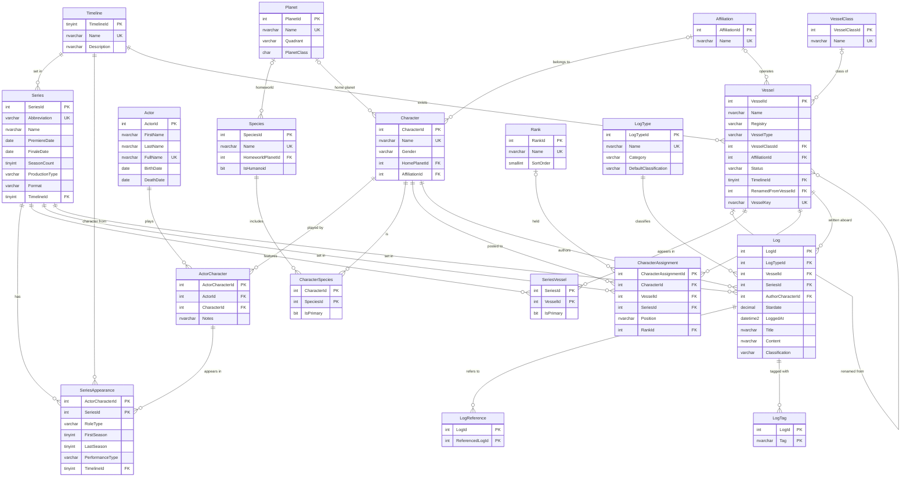

# StarTrek.Database

A Star Trek themed demo database for **Azure SQL Database** / **SQL Server**. It covers actors, the characters they played, the series they appeared in, and the ships and stations those characters served on. Species, planets, affiliations and ranks are included too.

It's built as an SDK-style [SQL Database Project](https://learn.microsoft.com/sql/tools/sql-database-projects/sql-database-projects) (`Microsoft.Build.Sql`). The schema is declarative, and the seed data loads through an idempotent post-deployment script.

## Scope

**Series**

| Series | Abbreviation | Notes |
|---|---|---|
| Star Trek: The Original Series | `TOS` | |
| Star Trek: The Next Generation | `TNG` | |
| Star Trek: Deep Space Nine | `DS9` | |
| Star Trek: Voyager | `VOY` | |
| Star Trek: Enterprise | `ENT` | |
| Star Trek: Discovery | `DIS` | Includes Mirror Universe Georgiou and Lorca |
| Star Trek: Picard | `PIC` | Includes the TNG crew reunion in season 3 |
| Star Trek: Lower Decks | `LD` | Animated; appearances are voice performances |
| Star Trek: Strange New Worlds | `SNW` | Data current through season 3 |
| Star Trek: Starfleet Academy | `SFA` | Season 1 (2026); lower confidence, see below |

**Films** (stored in the same `Series` table with `ProductionType = 'Film'`)

| Era | Films |
|---|---|
| TOS crew (Prime) | `TMP` The Motion Picture, `TWOK` The Wrath of Khan, `TSFS` The Search for Spock, `TVH` The Voyage Home, `TFF` The Final Frontier, `TUC` The Undiscovered Country |
| TNG crew (Prime) | `GEN` Generations, `FC` First Contact, `INS` Insurrection, `NEM` Nemesis |
| Kelvin timeline | `ST09` Star Trek (2009), `STID` Star Trek Into Darkness, `STB` Star Trek Beyond |

The data covers main casts plus key recurring characters for each series, and main and key supporting casts for each film: about 240 characters, 250 actors and 30 ships. Season ranges and role types are best-effort. Birth dates are only populated where they're well known, so expect `NULL`s; that's handy for demos anyway.

**Known uncertainty:**
- Starfleet Academy is the newest production. Its premiere date, cast, character names, the USS Athena setting and the crew positions are lower confidence than the rest.
- Some season ranges are the minimum known span rather than an exact one.
- The USS Kelvin is placed in the Kelvin timeline. It's destroyed at the moment the timelines diverge, so it could arguably be shared with Prime.
- Fields we weren't sure about (classes, launch years, ranks, birth dates) are left `NULL` rather than guessed.

### Reference data sources

The seed data was hand-compiled rather than imported, so use these to verify or extend it:

- [Memory Alpha](https://memory-alpha.fandom.com/wiki/Portal:Main): the canon Star Trek wiki, covering characters, actors, species, planets, ships and starbases.
- [StarTrek.com Database](https://www.startrek.com/database): the official franchise reference.
- [STAPI](https://stapi.co/): a free, open Star Trek REST API, handy for bulk-loading more data.
- [Wikipedia: List of Star Trek characters](https://en.wikipedia.org/wiki/List_of_Star_Trek_characters).
- Cast lists on IMDb and Memory Alpha:

| Series | IMDb | Memory Alpha |
|---|---|---|
| TOS | [tt0060028](https://www.imdb.com/title/tt0060028/fullcredits) | [TOS](https://memory-alpha.fandom.com/wiki/Star_Trek:_The_Original_Series) |
| TNG | [tt0092455](https://www.imdb.com/title/tt0092455/fullcredits) | [TNG](https://memory-alpha.fandom.com/wiki/Star_Trek:_The_Next_Generation) |
| DS9 | [tt0106145](https://www.imdb.com/title/tt0106145/fullcredits) | [DS9](https://memory-alpha.fandom.com/wiki/Star_Trek:_Deep_Space_Nine) |
| VOY | [tt0112178](https://www.imdb.com/title/tt0112178/fullcredits) | [VOY](https://memory-alpha.fandom.com/wiki/Star_Trek:_Voyager) |
| ENT | [tt0244365](https://www.imdb.com/title/tt0244365/fullcredits) | [ENT](https://memory-alpha.fandom.com/wiki/Star_Trek:_Enterprise) |
| SNW | [tt12327578](https://www.imdb.com/title/tt12327578/fullcredits) | [SNW](https://memory-alpha.fandom.com/wiki/Star_Trek:_Strange_New_Worlds) |
| DIS | [tt5171438](https://www.imdb.com/title/tt5171438/fullcredits) | [DIS](https://memory-alpha.fandom.com/wiki/Star_Trek:_Discovery) |
| PIC | [tt8806524](https://www.imdb.com/title/tt8806524/fullcredits) | [PIC](https://memory-alpha.fandom.com/wiki/Star_Trek:_Picard) |
| LD | [tt9184820](https://www.imdb.com/title/tt9184820/fullcredits) | [LD](https://memory-alpha.fandom.com/wiki/Star_Trek:_Lower_Decks) |
| SFA | | [SFA](https://memory-alpha.fandom.com/wiki/Star_Trek:_Starfleet_Academy) |
| Films | | [Star Trek films](https://memory-alpha.fandom.com/wiki/Star_Trek_films) |

## Schema



### Design notes

- **Actor ↔ Character is many-to-many** (`ActorCharacter`).
  - One character can have several actors, for example Spock is played by Leonard Nimoy and Ethan Peck, and Pike by three actors.
  - One actor can play several characters, for example Brent Spiner plays Data, Lore, Noonien Soong and Arik Soong.
- **Series and films share one table.** `Series` holds every production: `ProductionType` is `Series` or `Film`, and `Format` is `Live-action` or `Animated`. Films have no `SeasonCount` (`CK_Series_ProductionShape`). Keeping them together means one join answers "every production an actor appeared in". The table keeps its `Series` name so existing queries and the crew-log tables don't change; filter on `ProductionType = 'Series'` when you only want TV.
- **`SeriesAppearance`** records an actor-as-character in a production:
  - For series, the role is `Main`, `Recurring` or `Guest`, with a season range.
  - For films, the role is `Main`, `Supporting` or `Cameo`, and the seasons are `NULL`.
  - `PerformanceType` is `On-screen` or `Voice`. Lower Decks rows are `Voice`, so the same actor and character can be voiced in LD and on-screen elsewhere (Jack Quaid as Boimler in LD and SNW).
- **Timelines** (`Timeline`: Prime, Kelvin, Mirror Universe):
  - A character is one row across timelines, so Kirk is a single character played by William Shatner and Paul Wesley (Prime) and Chris Pine (Kelvin).
  - The timeline lives on the appearance (`SeriesAppearance.TimelineId`, defaulting from the production). That lets Leonard Nimoy's Spock Prime appear in the Kelvin films as Prime, and Nero is recorded as a Prime-timeline character for the same reason.
  - Mirror Universe counterparts with their own arcs (Mirror Georgiou, Mirror Lorca) are separate characters with a "(Mirror)" suffix, because they're different people rather than recasts.
- **Vessels per timeline.** `Vessel.TimelineId` lets the Kelvin USS Enterprise NCC-1701 coexist with the Prime one; the registry is unique per timeline (`UX_Vessel_Registry`).
  - `VesselKey` adds a timeline suffix outside Prime, for example `NCC-1701 (Kelvin)`, so Prime keys are unchanged.
  - `RenamedFromVesselId` records a rename: the USS Titan-A (status `Renamed`) became the USS Enterprise-G. Demo 25 walks the lineage with a recursive CTE.
  - The seed scripts throw if a production's ships or postings come from a different timeline.
- **`CharacterSpecies`** supports hybrids such as Spock, Troi and B'Elanna. A filtered unique index (`UX_CharacterSpecies_OnePrimary`) enforces one primary species per character.
- **`CharacterAssignment`** records who served on which ship or station, in which series, in what position and at what rank.
- **`Vessel.VesselKey`** is a persisted computed column: the registry, or the name when there's no registry, plus the timeline suffix described above. The value is cast to `NVARCHAR` first, so a long or Unicode name isn't truncated to the registry's `VARCHAR(20)`. It gives every vessel a unique natural key, including those without a registry, such as Deep Space 9.
- **Crew logs** (LogType, Log, LogReference, LogTag) reuse Vessel and Character, so a log is written by a character aboard a vessel at a stardate. Log.SeriesId records which series the entry belongs to, because ships and characters span series (the Enterprise NCC-1701 and Spock appear in both TOS and SNW). Tags and references inherit their series from the log. The seed script checks that the author has a CharacterAssignment on that vessel in that series.
  - LogType has a Category (Personal, Command, Department) and a DefaultClassification. Types: Personal, Captain's, Chief Engineer's, Medical / Chief Medical Officer's, Science Officer's, Tactical, Security, Counselor's, Operations.
  - Log.Classification is Public, Classified, Confidential or Private (CK_Log_Classification). Personal logs are seeded as Confidential or Private, and the seed script throws if one isn't.
  - LogReference links a log to another log about the same incident. A CHECK blocks self-references, and the composite primary key blocks duplicates. LogTag holds free-form tags, unique per log.
  - **Privacy:** read logs through dbo.PublicLog, which returns only Public, non-personal logs. dbo.MyLog is the my logs pattern: all public logs plus everything the viewer wrote, where the viewer comes from `SESSION_CONTEXT(N'ViewerCharacterId')` rather than a caller argument. Querying dbo.[Log] directly bypasses both, so grant access to the view rather than the table. A trusted layer must set the context with `@read_only = 1` (the session can't change it afterwards); the database does not authenticate that value, so a real application should also map it from the authenticated principal or use row-level security.
  - **Triggers** (TR_Log_Integrity, TR_LogReference_SameSeries) enforce rules a CHECK can't: personal logs must be Confidential or Private, the author must have a CharacterAssignment on that vessel in that series, and references stay within one series. Cross-ship links within a series are allowed.
  - Stardates and log text are illustrative original paraphrases, not canon-exact.
- **Schema changes** ship as a declarative model: SqlPackage diffs the .dacpac against the target on publish, so there are no migration scripts. Publishing adds the log tables and seed rows to an existing StarTrek database. Likewise, publishing over an earlier version adds `Timeline` and the new columns; their defaults (`Series`, `Live-action`, `On-screen`, Prime) keep existing rows valid.
- **Conventions:**
  - Constraints are named explicitly (`PK_`, `FK_`, `UQ_`, `CK_`, `DF_`, `IX_`, `UX_`).
  - Every FK column is indexed.
  - `CHECK` constraints cover enumerations and season and date ranges.
  - Every table has a `CreatedAt DATETIME2(0)` column defaulting to `SYSUTCDATETIME()`.

## Project layout

```
StarTrek.Database.sqlproj
global.json                           pins the minimum .NET SDK (10.0)
dbo/Tables/*.sql                      one file per table, with its indexes
dbo/Views/PublicLog.sql              non-private logs only
dbo/Views/MyLog.sql                 public logs plus the viewer's own (SESSION_CONTEXT)
Scripts/PostDeployment/
    Script.PostDeployment.sql         includes the seed files in dependency order
    Seed.Lookups.sql                  Timeline, Series (incl. films), Affiliation, Rank, VesselClass
    Seed.PlanetsSpecies.sql           Planet, Species
    Seed.Vessels.sql                  Vessel, SeriesVessel
    Seed.Actors.sql                   Actor
    Seed.Characters.sql               Character, CharacterSpecies
    Seed.Appearances.sql              ActorCharacter, SeriesAppearance
    Seed.Assignments.sql              CharacterAssignment
    Seed.Logs.sql                     LogType, Log, LogReference, LogTag
Scripts/Demo/DemoQueries.sql          demo queries: joins, recasts, window functions, PIVOT, ROLLUP...
```

Each seed section:

1. Supplies its source rows either as an inline `VALUES` row constructor (lookups, planets, actors) or by loading a temp table first (everything that references other tables by name).
2. Where the rows reference other tables by name, validates every lookup and `THROW`s with a clear message if a name doesn't resolve.
3. `MERGE`s into the target on the natural key.

Re-publishing is safe: changed rows are updated, new rows are inserted, and nothing is deleted.

## Requirements

| Tool | Version | Used for | Install |
|---|---|---|---|
| [.NET SDK](https://dotnet.microsoft.com/download/dotnet/10.0) | 10.0 or later, latest patch recommended (enforced by `global.json`) | Building the project (`Microsoft.Build.Sql` 2.3.0 SDK, restored from NuGet automatically), and running SqlPackage. The SDK includes the runtime. | `winget install Microsoft.DotNet.SDK.10` |
| [SqlPackage](https://learn.microsoft.com/sql/tools/sqlpackage/sqlpackage-download) | 170.x | Publishing the `.dacpac` | `dotnet tool install -g microsoft.sqlpackage` |
| [SQL Server Express LocalDB](https://learn.microsoft.com/sql/database-engine/configure-windows/sql-server-express-localdb) | 2019 or later | Local target (optional) | Included with Visual Studio, or via the SQL Server Express installer |
| [sqlcmd](https://learn.microsoft.com/sql/tools/sqlcmd/sqlcmd-utility) | Any | Running the demo queries from the command line (optional) | `winget install sqlcmd` |
| [Azure CLI](https://learn.microsoft.com/cli/azure/install-azure-cli) | Any | Signing in for Azure SQL (`Active Directory Default`) (optional) | `winget install Microsoft.AzureCLI`, then `az login` |

Optional editors: VS Code with the **SQL Database Projects** extension, or Visual Studio 2022 17.12+ with SQL Server Data Tools, SDK-style.

Check what's installed:

```powershell
dotnet --list-sdks
dotnet --list-runtimes
sqlpackage /Version
sqllocaldb info
```

> **.NET 10 is the minimum.** .NET 8 reaches end of support in November 2026. `global.json` in this folder requires SDK 10.0.100 or later; newer major versions are allowed.
>
> **Keep .NET 10 patched.** Recent SqlPackage builds need a recent .NET 10 runtime patch (for example, SqlPackage 170.5.x needs 10.0.11+), and won't start on an older one. If `sqlpackage` fails with *"You must install or update .NET to run this application"*, update .NET 10 (`winget upgrade Microsoft.DotNet.SDK.10`) or pin an older tool, e.g. `dotnet tool update -g microsoft.sqlpackage --version 170.2.70`.

## Build and publish

```powershell
cd src\Databases\StarTrek.Database
dotnet build

dotnet tool install -g microsoft.sqlpackage

# LocalDB
sqlpackage /Action:Publish `
  /SourceFile:bin\Debug\StarTrek.Database.dacpac `
  /TargetConnectionString:"Server=(localdb)\MSSQLLocalDB;Database=StarTrek;Integrated Security=true;TrustServerCertificate=true"

# Azure SQL Database (Microsoft Entra authentication)
sqlpackage /Action:Publish `
  /SourceFile:bin\Debug\StarTrek.Database.dacpac `
  /TargetConnectionString:"Server=tcp:<server>.database.windows.net,1433;Database=StarTrek;Authentication=Active Directory Default;Encrypt=True"
```

You can also open the project in VS Code (SQL Database Projects extension) or Visual Studio and publish from there.

## Demo queries

Open `Scripts\Demo\DemoQueries.sql` against the published database. Highlights include:

- Recast characters and multi-role actors (`STRING_AGG ... WITHIN GROUP`)
- Actors appearing across the most series
- `LEFT JOIN` vs `NOT EXISTS` anti-joins (the runabout USS Rio Grande has no crew on purpose)
- Hybrid species via conditional aggregation
- Window functions (`DENSE_RANK`, `COUNT(*) OVER`)
- `PIVOT`, `GROUP BY ROLLUP`, and a filtered index seek (`IX_SeriesAppearance_MainCast`)
- Prime vs. Kelvin casting side by side, and actors who span both TV series and films
- Voice vs. on-screen performances of the same character (Lower Decks)
- Ship lineage with a recursive CTE (Titan-A to Enterprise-G), and one registry across timelines
- Productions by decade, format and timeline
